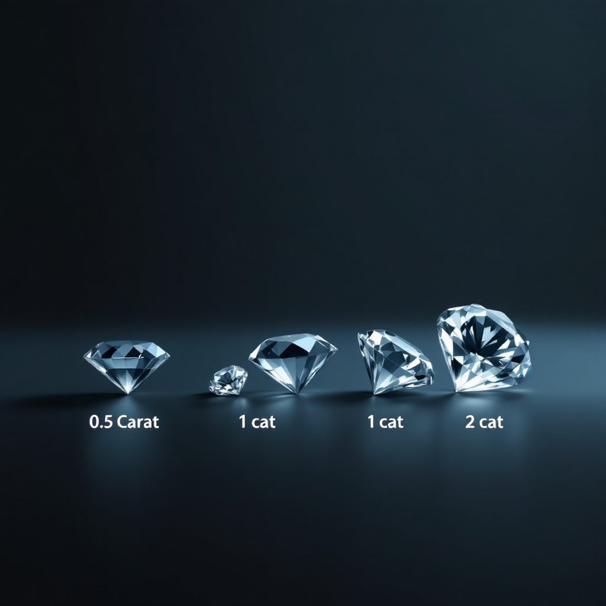

::: banner_image
PORTFOLIO
:::
 
 

## My Projects {#projects}

:::::: projects-grid
::: project-card
### Project 1

:::

::: project-card
### Project 2

:::

::: project-card
### Project 3

:::
::::::

## About Me {#aboutme}

I’m a Finance and Business Analytics student at Al Akhawayn University in Ifrane, currently completing an academic exchange semester at Baldwin Wallace University in the United States. This experience has allowed me to broaden my global perspective while deepening my understanding of international business, marketing, entrepreneurship, and data science.

At Baldwin Wallace, I’ve been involved in the Investment Club and the Bloomberg Global Trading Challenge, applying analytical and financial concepts to real-world market simulations. I’ve also worked on projects that connect data-driven insights with business innovation, strengthening my ability to approach problems from multiple perspectives.

Back at AUI, I’ve developed a strong foundation in financial analysis and business analytics, serving as Head of Sponsoring for the UNICEF Club and General Secretary of the Industry Club, and representing my university in the Hult Prize competition. These experiences have helped me build strong leadership, teamwork, and communication skills.

I’m passionate about the intersection of finance, data, and innovation, and how they can drive strategic decisions and sustainable growth.

<a href="Resume_Fall_2025.pdf" target="_blank" style="text-decoration: none;"> <button style="background-color:#000000; color:white; border:none; padding:10px 15px; border-radius:5px; cursor:pointer;"> Download Resume </button> </a>

## Contact {#contact}

Here is how you can contact me: <link rel="stylesheet" href="https://cdnjs.cloudflare.com/ajax/libs/font-awesome/6.4.0/css/all.min.css">

::: {style="display: flex; gap: 10px;"}
<a href="mailto:linazaroual2@gmail.com" target="_blank" style="text-decoration: none;"> <button style="background-color:#D44638; color:white; border:none; padding:10px 15px; border-radius:5px; cursor:pointer;"> <i class="fas fa-envelope"></i> Gmail </button> </a> <a href="https://www.linkedin.com/in/lina-zaroual-14b0ba345/" target="_blank" style="text-decoration: none;"> <button style="background-color:#0A66C2; color:white; border:none; padding:10px 15px; border-radius:5px; cursor:pointer;"> <i class="fab fa-linkedin"></i> LinkedIn </button> </a> <a href="https://github.com/Lina-zar" target="_blank" style="text-decoration: none;"> <button style="background-color:#333; color:white; border:none; padding:10px 15px; border-radius:5px; cursor:pointer;"> <i class="fab fa-github"></i> GitHub </button> </a>
:::
